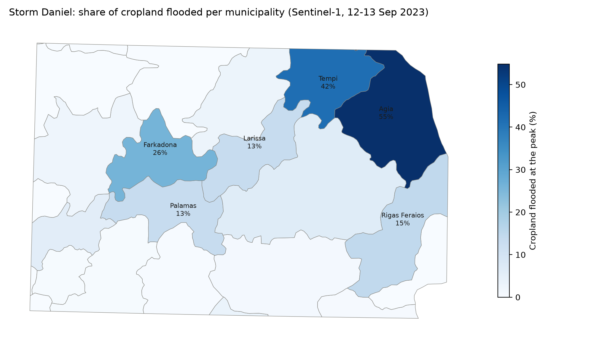
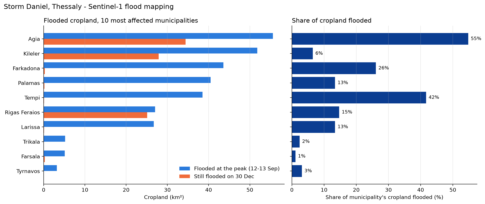
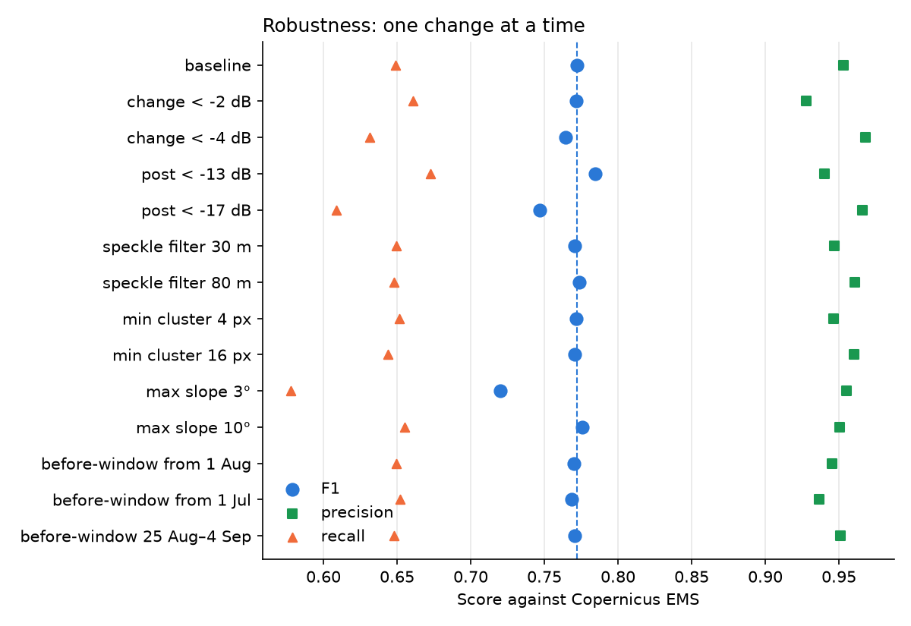
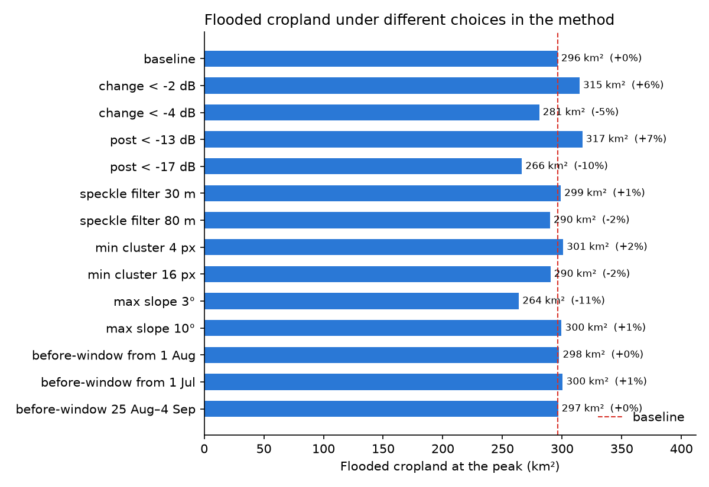

# Storm Daniel: flooded cropland in Thessaly (Sep 2023)

Sentinel-1 SAR change detection of the flood extent on 12–13 Sep 2023, validated against
Copernicus EMS and combined with land cover and municipal boundaries to estimate flooded
cropland, and how long the water stayed, per municipality.



## Key results
- Total flooded area at the peak (12–13 Sep): ~341 km²
- Flooded cropland: ~302 km² (~302,000 stremmata), 9.2% of the cropland in the study area (~89% of all flooded land), a lower bound (see Robustness and Limitations); about −11% / +7% under reasonable variations of the method (see Robustness)
- Most affected: Agia (55.6 km², 54.8% of its cropland), Kileler, Farkadona, Palamas, Tempi
- Validation against Copernicus EMS (EMSR692): precision 0.95, recall 0.65, F1 0.77 (flood traces excluded; recall ranges from 0.40 to 0.93 between the four EMS areas)
- Recession: the western plain (Palamas–Karditsa) fell below 10% of the peak extent about 11 days after the peak, rose again to ~37% around 1 Oct (most likely new water from Storm Elias, 27–28 Sep) and was dry (<2%) from late October; the Larissa/Pineios area dropped to 11–16%, but the Karla basin was still 85–87% flooded after 3.5 months
- On 30 Dec, ~89 km² of the flooded cropland was still under water, mostly in Agia, Kileler and Rigas Feraios (three small municipalities the 30 Dec pass did not see well enough are not counted)



## Notebooks
| Notebook | What it does |
|---|---|
| `01_sentinel1_flood_mapping` | Flood map from Sentinel-1 (same-orbit before/after, speckle filter, thresholds) |
| `02_validation_copernicus_ems` | Agreement with Copernicus EMS (EMSR692), sensitivity to the thresholds and other choices, per-area scores, bootstrap confidence interval |
| `03_flood_recession_timeseries` | Share of the peak flood still under water, pass by pass, until 31 Dec |
| `04_flood_impact_landcover_municipalities` | Flooded land cover (ESA WorldCover) and cropland per municipality |
| `05_robustness_of_results` | How much the headline numbers change if the method's choices change |
| `06_final_figure_and_readme` | Summary figure and pre-publish checks |

Shared code is in `src/flood.py`. Results (CSV, figures) are written to `outputs/`.
The interactive maps (geemap) are only shown when a notebook is run; on GitHub they appear empty.

```
thessaly_flood/
├── notebooks/   01–06
├── src/         flood.py (the method as functions)
├── data/        boundaries/ (downloaded by notebook 04), ems/ (not included)
├── outputs/     CSV tables and figures
├── README.md, LICENSE, requirements.txt, .gitignore
```

## Method
1. Sentinel-1 GRD (IW, VV), same relative orbit before and after: pre-event median vs post-event mosaic,
   50 m focal median against speckle, difference in dB
2. Flooded = change < −3 dB and post-event backscatter < −15 dB
3. Removal of permanent water (JRC), slopes ≥ 5° and isolated groups of < 8 pixels
4. Peak extent = union of the 12 Sep (orbit 175) and 13 Sep (orbit 7) passes
5. Overlay with ESA WorldCover 2021 and municipal boundaries (geoBoundaries ADM3)

## Robustness
Changing one choice of the method at a time (`SCENARIOS` in `src/flood.py`, notebooks 02 and 05):

- **Agreement with EMS:** F1 stays at 0.77 ± 0.01 when the speckle filter, the minimum cluster size or the length of the
  "before" window change. The dB thresholds and the slope limit matter most (F1 between 0.72 and 0.78).
- **Uncertainty of the score** (block bootstrap, 95%): precision 0.94–0.96, recall 0.62–0.68, F1 0.75–0.79. This covers sampling
  within the four validated areas only, not errors of the EMS map or areas without a reference.
- **By EMS area:** precision is 0.94–0.98 everywhere, but recall is 0.93 where large open water stood and 0.40–0.61 in the others.
- **Timing:** the Sentinel-1 passes are 7.6 h and 19.6 h after the EMS image of 12 Sep. Recall is a few points higher with the earlier pass (AOI02 0.60 vs 0.52, AOI03 0.58 vs 0.52, AOI05 0.38 vs 0.33) and is higher against the 14 Sep EMS maps (0.84, 0.70 and 0.45 for AOI02, AOI03 and AOI05), consistent with part of the gap being water that receded in between. In AOI05 recall stays at 0.33–0.45 for every combination, so timing does not explain it.
- **By land cover** (against the 12 Sep EMS maps): cropland is 85% of the EMS-mapped flooded area and the best-detected class (precision 0.97, recall 0.69; AOI04 0.96, AOI02 0.64, AOI03 0.70, AOI05 0.42). Grass/shrub 0.56, tree cover 0.22 and built-up 0.19 are detected much worse.
- **By depth** (EMS water-depth estimate, flooded cropland): recall rises from 0.51 for 0.15–0.5 m (54% of the EMS-mapped area) to 0.83 for 0.5–1 m, 0.93 for 1–2 m and 0.98 above 2 m. The share of shallow water differs a lot between areas (20% in AOI04, 42% in AOI03, 61% in AOI02, 99.6% in AOI05), which largely explains why recall differs between them (0.96, 0.70, 0.64, 0.42).
- **Edge effect:** within 60 m of the EMS boundary recall is 0.27–0.84, in the interior 0.67–0.99. Edge pixels are about a quarter of the EMS-mapped flooded cropland but roughly half of the water we miss. Interior shallow water (0.15–0.5 m) is still detected only at 0.67.
- **Boundary placement:** inside the validated zones our flooded area is 309 km² against 453 km² mapped by EMS (68%). Growing our map by one pixel (30 m) gives 360 km² (recall 0.73, precision 0.92), by two pixels 399 km² (recall 0.79, precision 0.89). About 73% of the area added by the first pixel lies inside the EMS flood extent, so our boundaries tend to sit slightly inside the EMS ones (possible reasons: mixed water/land pixels at the edge, the 50 m speckle filter, water receding between the images). This is a diagnostic; the map is not corrected.
- **Effect on the headline number:** flooded cropland moves between −11% and +7% (264–317 km² around a 296 km² baseline on a 30 m grid).
  The largest changes come from the slope limit (3°), the post-event threshold (−17 / −13 dB) and the change threshold (−2 / −4 dB).
  This range covers parameter choices only. Boundary placement is a separate uncertainty: growing the map by 30 m adds about 16% of flooded area.




## Limitations
- Radar detects the water it sees with very high precision but misses part of it: against EMS it found about 65% of the mapped standing water overall (69% on cropland), and only 40% in AOI05. Flooded areas are therefore a lower bound.
- What is missed is mostly the shallowest water: against the EMS depth estimate, recall is 0.51 for 0.15–0.5 m but 0.83–0.98 above 0.5 m (see Robustness). Roughly half of the missed water lies within 60 m of the EMS boundary, and the EMS depth is itself an estimate.
- SAR misses shallow water among tall crops and flooding in built-up areas (double-bounce), so flooded
  cropland is a lower bound and flooded built-up land (~1.5 km²) is certainly underestimated.
- Persistent water in the Karla basin is very likely the former lake refilling, but Sentinel-1 cannot tell the cause (interpretation, not a measured fact).
- The EMS reference images were taken at ~08:54 UTC on 12 Sep, the Sentinel-1 passes at 16:32 UTC on 12 Sep and 04:31 UTC on 13 Sep (7.6 h and 19.6 h later), while the water was still changing, so agreement with EMS is not a same-instant comparison.
- Municipalities are clipped to the study area, so those only partly inside it are under-counted.
- Municipalities with no value on 30 Dec (Trikala, Mouzaki, Lake Plastiras) were not seen well enough by that pass.
  This is not the same as zero.

## Reproduce
```
pip install -r requirements.txt
earthengine authenticate
```
Create a text file `project_id.txt` in the project root containing only your Google Cloud project id
(the one registered for Earth Engine). It is listed in `.gitignore`, so it is never uploaded.
Then run the notebooks in `notebooks/` (01–06) in order.

## Data
- Sentinel-1 GRD, JRC Global Surface Water, SRTM and ESA WorldCover 2021 are read through Google Earth Engine.
  Contains modified Copernicus Sentinel data (2023).
- Copernicus EMS rapid-mapping products (activation EMSR692) are **not included**: download them from the
  Copernicus EMS portal and unzip each product into `data/ems/` (needed only for notebook 02).
  References used: AOI02–04 `DEL_MONIT01` and AOI05 `DEL_MONIT02`, all drawn from SPOT-6/7 images of 12 Sep 2023 (~08:54 UTC).
  The second products of each area (14 Sep 2023, SPOT-6/7 and WorldView-3) are used for the timing test.
- Municipal boundaries: geoBoundaries (GRC-ADM3), Runfola et al. (2020), PLOS ONE 15(4): e0231866,
  https://www.geoboundaries.org, distributed under CC BY 4.0 (see the boundary's metadata for its source and license).
  Notebook 04 downloads it automatically if `data/boundaries/` is empty.

## License
The code is released under the MIT License (see `LICENSE`). The data sources listed above keep their own licences and terms of use.
